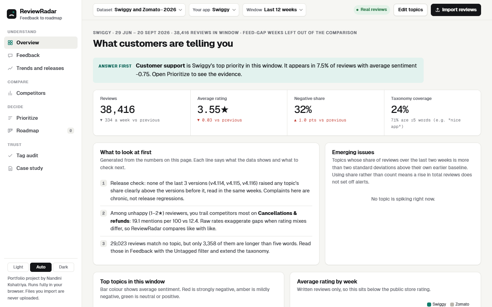
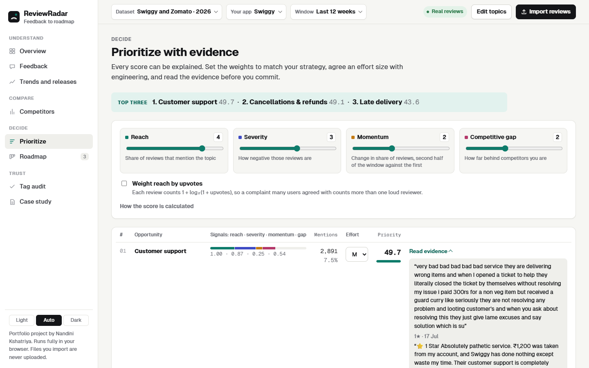
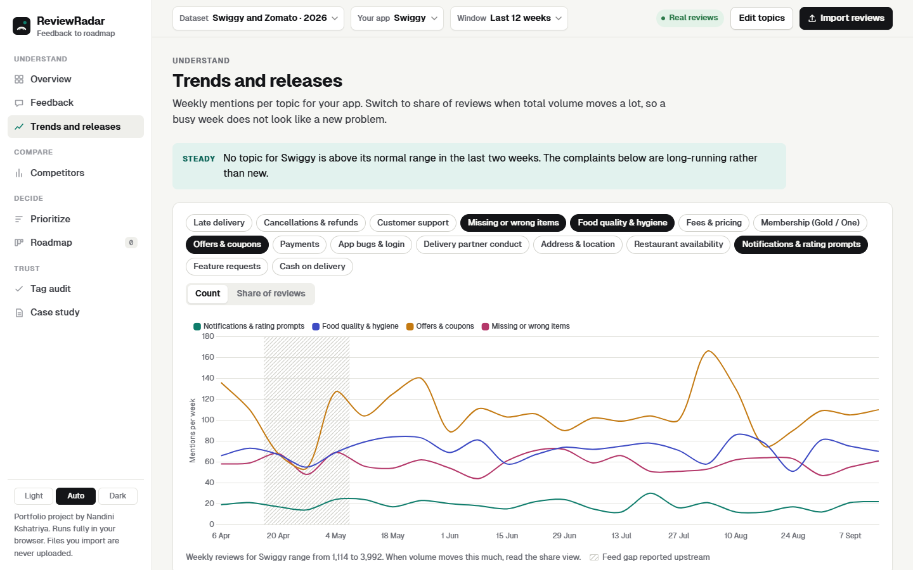
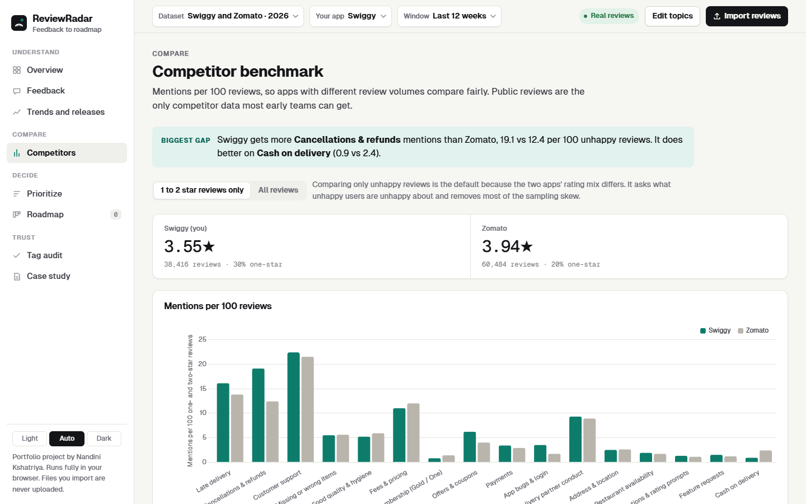
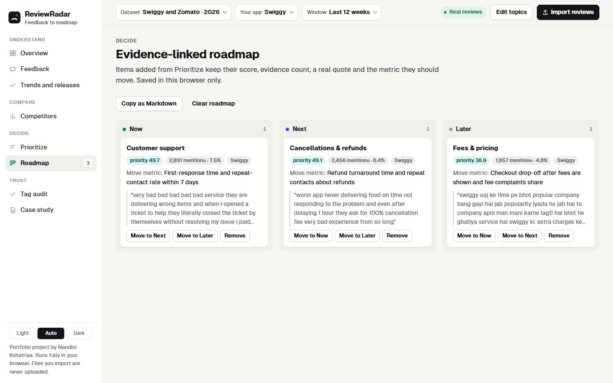
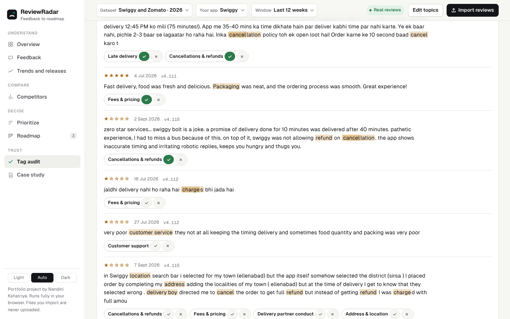
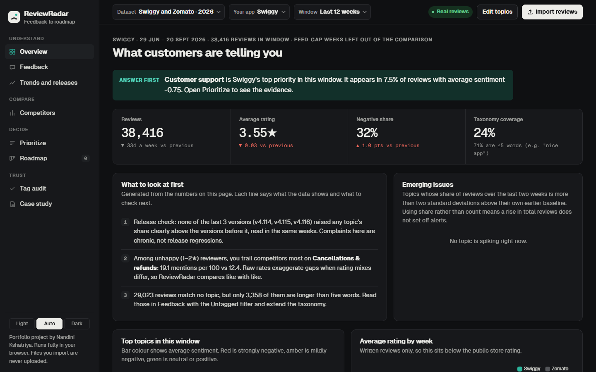
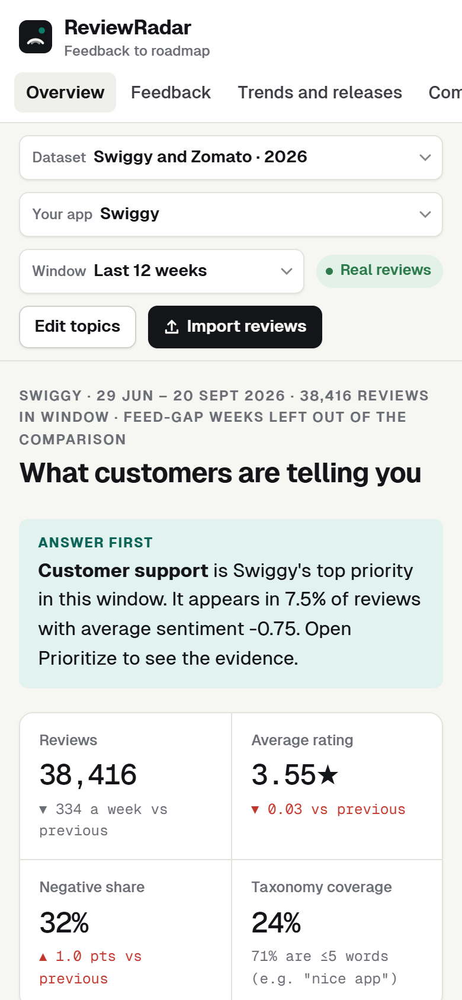
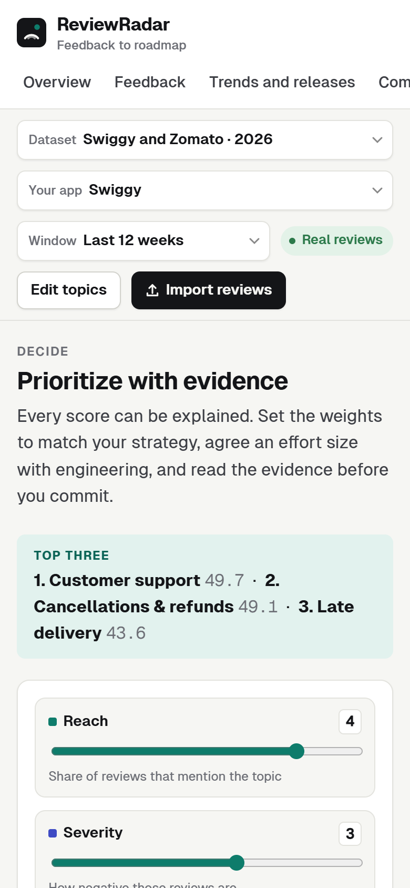

# ReviewRadar

ReviewRadar turns public app-store reviews into a product roadmap a PM can defend. It tags reviews into topics, checks each release for regressions, compares complaint rates with a competitor fairly, and ranks what to fix with a score you can explain. Every ranked item links back to the real reviews behind it.

It ships with **228,274 real Google Play reviews of Swiggy and Zomato written between 6 April and 20 September 2026**, plus an older 2023 dataset and a simulated rider-app dataset. The source file holds 237,961 reviews. The 9,687 dated 1 to 5 April are left out because they fall in a partial week, so every week in the app runs Monday to Sunday.

Portfolio project by Nandini Kshatriya, built while preparing for Associate Product Manager roles.

- **Live demo:** see the link in the repository description (hosted as a static page)
- **Product case study:** [`docs/case-study.md`](docs/case-study.md), also inside the app under *Case study*
- **Research notes:** [`research/`](research)



## What it does

| View | What a PM gets |
|---|---|
| Overview | One sentence that answers "what matters most right now", then volume, rating, negative share, taxonomy coverage, spike alerts and generated insights |
| Feedback | Search and filter every review by topic, rating and sentiment, with matched keywords highlighted |
| Trends and releases | Weekly topic trends, share-based spike detection, and a release check that compares each app version with older versions reviewed in the same weeks |
| Competitors | Mentions per 100 reviews with 95% confidence intervals, defaulting to a comparison of unhappy (1 to 2 star) reviews only. Gaps that would not survive a correction for testing every topic are marked as weak. |
| Prioritize | A transparent score built from reach, severity, momentum and competitive gap, with adjustable weights, effort sizing and evidence quotes |
| Roadmap | A Now, Next and Later board where each item keeps its score, evidence count, a real quote and a suggested success metric. Exports to Markdown. |
| Tag audit | Judge a random sample of tags and get precision per topic with Wilson 95% intervals |
| Case study | The full APM write-up: problem, research, a recommendation with a planned experiment, PRD, trade-offs, metrics and limits |

## Key finding from the 2026 data

On raw complaint rates, Swiggy looks worse than Zomato on 14 of 16 topics over the last 12 weeks. Comparing only unhappy reviews, and correcting for testing 16 topics at once, it is clearly behind on 4 and clearly ahead on 2. The largest gap, and one that survives every robustness check, is cancellations and refunds (19.1 vs 12.4 mentions per 100 unhappy reviews), and about a third of it is complaints about cancellation charges. The case study turns that into one recommendation, a short free-cancellation window after ordering, with a success metric and a planned A/B test that has not been run.

## Tech stack

| Layer | What is used |
|---|---|
| Frontend | A single `index.html` with vanilla JavaScript (no framework), hand-written CSS with light and dark themes |
| Charts | Chart.js 4.4.1, vendored in `vendor/` |
| CSV import | PapaParse 5.4.1, vendored in `vendor/` |
| Fonts | Geist and Geist Mono, self-hosted in `fonts/` (SIL Open Font License) |
| Data | Precomputed JSON in `data/`, built offline with Python 3 and pandas |
| Backend and database | None. Everything runs in the browser. Saved tags, weights and roadmap items live in the browser's `localStorage`. Imported files are never uploaded. |
| Hosting | Any static host (GitHub Pages, Netlify, Vercel, Cloudflare Pages) |

## Run it locally

The app fetches its dataset with `fetch()`, so open it through a local web server rather than double-clicking the file. The VS Code Live Server extension works too (right-click `index.html` and choose *Open with Live Server*).

```bash
git clone <this repository>
cd reviewradar
python3 -m http.server 8000
# open http://localhost:8000
```

No build step and no install is needed to run the app.

## Rebuild the dataset (optional)

```bash
pip install pandas
# download data/raw/swiggy.csv.gz and data/raw/zomato.csv.gz from
# https://github.com/Adithya-Monish-Kumar-K/ba-capstone-app-reviews (commit 019dae4)
python3 scripts/prepare_data_2026.py swiggy.csv.gz zomato.csv.gz data/zomato_swiggy_2026.json
```

The script records every dropped row in the file's `meta.dropped`, and a rebuild from commit 019dae4 reproduces the shipped rows exactly. On Windows, use `py -3` in place of `python3`.

`scripts/prepare_data.py` rebuilds the 2023 file from the upstream CSVs. `scripts/build_case.py` renders `docs/case-study.md` into the app's Case study view. It uses the `marked` CLI from npm and falls back to `npx` if `marked` is not installed.

## Use your own reviews

Click **Import reviews** and drop in one CSV per app. ReviewRadar reads the columns that the open-source `google-play-scraper` Python package exports (`content`, `score`, `at`, `reviewCreatedVersion`) as well as Kaggle-style names. The import dialog shows a short script to export reviews for any app.

## Environment variables

None are needed. The app is static and has no server, API keys or secrets. A [`.env.example`](.env.example) file is included to make that explicit.

## Deploy

1. Push this folder to a GitHub repository.
2. In the repository settings, open **Pages**, choose **Deploy from a branch**, and pick `main` with the root folder.
3. The site appears at `https://<username>.github.io/reviewradar/` within a few minutes.

The 2026 data file is about 14 MB, which is within GitHub's 100 MB file limit and loads in a few seconds on broadband.

## Data sources and honesty notes

| Dataset | Source | Collection method | Caveats |
|---|---|---|---|
| Swiggy and Zomato, Apr to Sep 2026 (default) | [ba-capstone-app-reviews](https://github.com/Adithya-Monish-Kumar-K/ba-capstone-app-reviews), commit 019dae4 | `google-play-scraper`, every English review from India, newest first, 1 Apr to 20 Sep 2026, documented in the source's `DATA_SOURCES.md` | Feed gap from 21 Apr to 5 May 2026 when positive reviews went missing (shaded in charts and left out of baselines, release checks and comparisons). Zomato has no reviews for 24 July. App version is missing for 11% of reviews. 68% of reviews are three words or fewer. No license is stated upstream, so it is used for a non-commercial demo with attribution. |
| Swiggy and Zomato, Jan to Jul 2023 | [tanishka-anand compilation](https://github.com/tanishka-anand/tanishka-anand-zomato-swiggy-review-intelligence) of a Kaggle scrape | Not documented upstream | Swiggy's reviews are 65% one-star against 33% for Zomato in the 26 weeks used, which suggests different sampling |
| Rider apps | Generated in the browser from hand-written templates | Seeded random generator | **Simulated.** No real users or reviews. |

Rebuilding both datasets from the upstream raw files reproduces every shipped row. The 2026 raw counts and date range match the upstream documentation, and the headline window counts, ratings and star shares were recomputed independently in pandas and match the app. I did not collect the reviews myself. No reviewer names or images are stored.

The app never shows an accuracy figure for its tags until a person has judged at least 10 of them in Tag audit.

## Project structure

```
index.html                 the whole app (markup, styles, logic)
data/                      review datasets as compact JSON
docs/case-study.md         APM case study (source of the in-app Case study view)
docs/screenshots/          screenshots used in this README
research/                  secondary research notes with sources, dates and sample sizes
scripts/                   data preparation and case-study build scripts
vendor/                    Chart.js and PapaParse with their licenses
fonts/                     self-hosted fonts with their license
```

## Screenshots

| | |
|---|---|
|  |  |
|  |  |
|  |  |

 

## Limits

- Keyword tags miss paraphrase and sarcasm, and some keywords also catch praise. Precision is unmeasured until someone runs the tag audit.
- Release attribution is approximate. The same-week comparison sets people who updated against people who did not, and those groups can differ.
- Swiggy's unhappy reviews are longer than Zomato's, which raises its keyword hit rates. The case study shows which gaps survive when length is controlled.
- Public reviews are self-selected. Read them for direction, not as population estimates.
- No user research was run for this project, and none of the planned experiments has been run. All user evidence is secondary and labelled in the case study.
